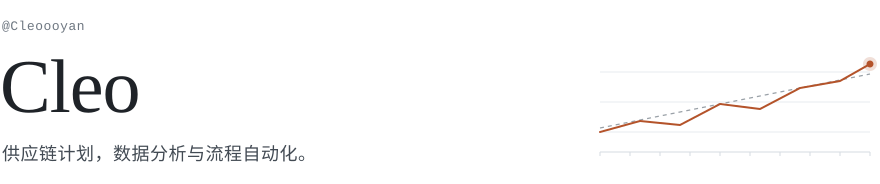
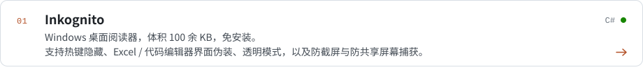
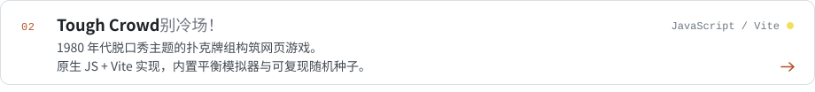
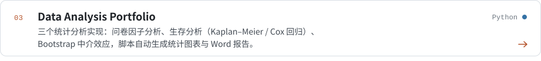
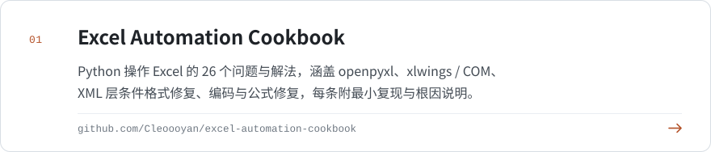
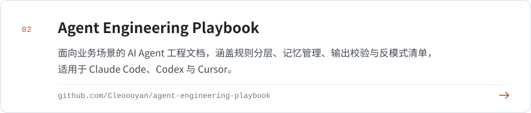

<picture>
  <source media="(prefers-color-scheme: dark)" srcset="assets/header-dark.svg">
  <source media="(prefers-color-scheme: light)" srcset="assets/header-light.svg">
  
</picture>

 

<picture>
  <source media="(prefers-color-scheme: dark)" srcset="assets/section-projects-dark.svg">
  <source media="(prefers-color-scheme: light)" srcset="assets/section-projects-light.svg">
  
</picture>

<a href="https://github.com/Cleoooyan/Inkognito">
  <picture>
    <source media="(prefers-color-scheme: dark)" srcset="assets/card-inkognito-dark.svg">
    <source media="(prefers-color-scheme: light)" srcset="assets/card-inkognito-light.svg">
    
  </picture>
</a>

<a href="https://github.com/Cleoooyan/tough-crowd">
  <picture>
    <source media="(prefers-color-scheme: dark)" srcset="assets/card-tough-crowd-dark.svg">
    <source media="(prefers-color-scheme: light)" srcset="assets/card-tough-crowd-light.svg">
    
  </picture>
</a>

<a href="https://github.com/Cleoooyan/data-analysis-portfolio">
  <picture>
    <source media="(prefers-color-scheme: dark)" srcset="assets/card-data-analysis-dark.svg">
    <source media="(prefers-color-scheme: light)" srcset="assets/card-data-analysis-light.svg">
    
  </picture>
</a>

 

<picture>
  <source media="(prefers-color-scheme: dark)" srcset="assets/section-docs-dark.svg">
  <source media="(prefers-color-scheme: light)" srcset="assets/section-docs-light.svg">
  
</picture>

<a href="https://github.com/Cleoooyan/excel-automation-cookbook">
  <picture>
    <source media="(prefers-color-scheme: dark)" srcset="assets/card-excel-cookbook-dark.svg">
    <source media="(prefers-color-scheme: light)" srcset="assets/card-excel-cookbook-light.svg">
    
  </picture>
</a>

<a href="https://github.com/Cleoooyan/agent-engineering-playbook">
  <picture>
    <source media="(prefers-color-scheme: dark)" srcset="assets/card-agent-playbook-dark.svg">
    <source media="(prefers-color-scheme: light)" srcset="assets/card-agent-playbook-light.svg">
    
  </picture>
</a>

